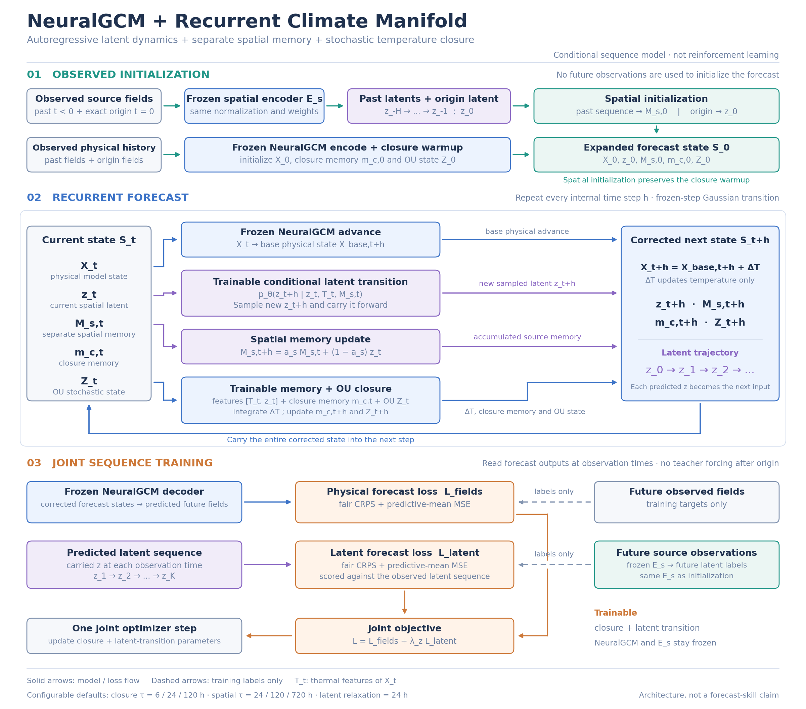

# NeuralGCM + recurrent manifold memory

An executable research baseline combining the **real pretrained NeuralGCM
forecast recurrence** with a learned stochastic latent transition and causal
memory closure. Climate Manifold observations initialize a spatial memory and
the latent at forecast origin; subsequent latents evolve as an explicit
`z_0 -> z_1 -> ...` conditional stochastic chain.

**Status:** implementation and numerical/interface validation, not a trained
weather model or demonstrated climate improvement. No trained Climate Manifold
weights or production NeuralGCM checkpoint are included. The official bundled
NeuralGCM toy fixture is used only to validate integration.

[한국어 실행 안내](docs/GUIDE_KO.md) · [Recurrent latent 구현 설명](docs/RECURRENT_LATENT_KO.md) · [Equations and scope](docs/DESIGN.md) · [이전 버전 점검](docs/MEMORY_AUDIT_KO.md)

## Optional KAI stage manifold correction (v0.3)

An additional PyTorch path now attaches independent correction adapters after
any of KAI-Atmos's four **full-resolution** stages. The original KAI backbone
is preserved, including its `downsample_layers` parameter names and stride-1
transitions. The existing JAX NeuralGCM training/forecast path is unchanged.

The real recurrent NeuralGCM generator advances once per physical forecast
interval and ensemble member. Its decoded pressure-temperature forecast and
carried stochastic latent are regridded explicitly and shared by all stage
adapters at that lead. CNN stage depth does **not** advance the physical clock
or resample noise. Modes are bounded learned `residual` correction and
`filter` nudging toward a learned guide lift; stage physical readouts have an
optional alignment objective.

This first integration uses a **frozen JAX guide generator** and trainable
PyTorch KAI adapters (optionally the backbone). NumPy guide export deliberately
breaks cross-framework autograd. It is not joint optimization of NeuralGCM
and KAI, nor a hard conservation/PDE projection. Physical guidance is currently
temperature-only; the full recurrent source latent is also supplied.

See **[KAI stage 구조·학습·실행 안내](docs/KAI_STAGE_MANIFOLD_KO.md)** for exact
interfaces, data preparation, temporal splits, original checkpoint loading,
and baseline/stage/noise ablations.

```bash
python -m pip install -e '.[kai,test]'
python scripts/smoke_kai.py
# Actual bundled toy NeuralGCM -> guide -> four KAI stages (CPU integration):
JAX_PLATFORMS=cpu python scripts/smoke_kai.py --real-neuralgcm
```

No trained guide or KAI checkpoint is included. The smoke test uses explicitly
synthetic/untrained components and validates interfaces, not weather skill.
The vendored KAI file retains its upstream BSD license in
[THIRD_PARTY_NOTICES.md](THIRD_PARTY_NOTICES.md).



## What is implemented

- Preserve NeuralGCM's pretrained learned physics and semi-implicit dynamical
  core. Apply an operator-split temperature correction once per accepted
  internal timestep, with explicit Kelvin/non-dimensional conversion.
- Multiscale exponential memory and an augmented Ornstein–Uhlenbeck SDE.
  Sample the **joint OU endpoint and time integral**, including their covariance.
- Exact JAX port of the source spatial encoder, preserving its trained
  normalization, field order, optional information encoder and variable fusion.
- A learned Gaussian transition conditioned on the current source latent,
  native temperature and separate spatial memory. Each internal step carries
  its sampled latent forward and uses the current latent in the thermal closure.
- Distinct spatial and closure memory states. Historical spatial initialization
  preserves thermal warmup and OU state. Source observations at the exact
  forecast origin initialize `z_0`; future observations are labels only.
- Joint field and latent ensemble scoring at observation times. The future
  latent trajectory is freely rolled out, never overwritten by teacher labels.
- Frozen-base differentiable multi-step training, temporal split, ensemble CRPS,
  RMSE, spread, bias and mean-drift evaluation. Explicit base-only comparison.

This is **not** a wholesale replacement of the dynamical-core ODE integrator.
NeuralGCM already has stochastic variants. The experiment is whether additional
statistical memory improves an existing hybrid physical model.

## Install and validate

```bash
git clone --recurse-submodules https://github.com/nayehyeon61-glitch/Neural-GCM-feat-stochastic.git
cd Neural-GCM-feat-stochastic
python3 -m venv .venv
source .venv/bin/activate
python -m pip install -e '.[test,export,netcdf]'
python -m pytest -q
python scripts/smoke_neuralgcm.py
python scripts/smoke_neuralgcm.py --recurrent-latent
```

The smoke script executes the official NeuralGCM toy checkpoint, checks exact
base-only equivalence, and differentiates a corrected forecast. It is a CPU
interface test, not a benchmark. A machine's working GPU JAX installation can be
used for training; GPU execution is not part of the local validation report.

The submodules are reference source checkouts, not competing Python installs:

| Source | Pinned revision | Use |
|---|---|---|
| `neuralgcm/neuralgcm` | `c91d2007ca37a4c0842f3ff83256d32e1ec30815` (`v1.2.2`) | Matching supported runtime API |
| `nayehyeon61-glitch/climate_manifold` | `bd1592fe9283f650b5b1f62deb7e196743b9db9a` | Latest reviewed spatial encoder architecture |

`pyproject.toml` pins NeuralGCM 1.2.2 and Dinosaur 1.5.0. Current NeuralGCM main
was also inspected, but its developing 1.2.3 API is not the supported runtime.
Upstream licenses remain in the submodules. Official pretrained NeuralGCM
weights have their own CC BY-SA 4.0 license; source checkpoints are not copied
or relicensed here.

## Run with actual data

See `python scripts/<script>.py --help` for exact arguments.

1. Obtain an official, trusted NeuralGCM checkpoint and your training data.
   `prepare_neuralgcm_data.py` maps standard ERA5 names and conservatively
   regrids a global field onto that checkpoint's data grid. All required
   pressure levels, SST and sea ice must be provided. Missing physical fields
   are errors. Inputs are read only.
2. Train/evaluate the native thermal-memory baseline with `train.py` and
   `evaluate.py`. Future boundary fields default to persistence. `observed`
   boundary mode is explicitly an observed-boundary hindcast.
3. For source statistical memory, export your actual spatial checkpoint with
   `export_spatial.py`, prepare past observed source fields with
   `prepare_spatial_history.py`, and pass `--spatial-history` to train/evaluate.
   Train the source encoder and its normalizations on training data only.
   Recurrent mode is the training default when history is supplied. Its training
   artifact must also contain exact origin/future observation timestamps for
   initialization and latent supervision. Evaluation needs history only through
   each origin. `--spatial-mode initialization` explicitly selects the previous
   initialization-only model; old saved checkpoints retain that behavior.

There is no silently generated source checkpoint. The source repository has
code but no tracked trained weights. Its usual surface inputs are
`msl,t2m,u10,v10`; those are not interchangeable with NeuralGCM sigma-level
temperature/wind or surface pressure. The pre-origin-history route makes a
valid connection without that substitution.

## Files

| File | Responsibility |
|---|---|
| `src/ngcm_memory/closure.py` | Exact auxiliary memory/OU integration |
| `src/ngcm_memory/latent.py` | Conditional Gaussian latent transition and separate spatial memory |
| `src/ngcm_memory/neuralgcm_adapter.py` | Real NeuralGCM state, units, and spectral correction |
| `src/ngcm_memory/spatial.py` | Exact source encoder JAX inference/export |
| `src/ngcm_memory/features.py` | Causal source history and explicit latent regridding |
| `src/ngcm_memory/training.py` | Corrected forecast recurrence, optimizer, checkpoint I/O |
| `src/ngcm_memory/metrics.py` | Probabilistic and drift metrics |
| `scripts/` | Data preparation, export, training, evaluation, smoke validation |

## Evaluation before claiming an improvement

Train independent base/memory/noise/full ablations with the same temporal
partitions, forcing policy, resolution, forecast starts and ensemble size.
Compare native-temperature memory, spatial-initialized memory and recurrent
latent memory. Keep
source encoder selection/normalization independent of the held-out period.
Use multiple seeds and report lead-dependent CRPS/RMSE/spread and climate
mean/variance, spectra and budget drift over longer runs. The supplied metrics
cover the initial forecast/bias comparison; climate spectra and complete
physical budget diagnostics require additional experiment-specific analysis.

Temperature-only corrections do not enforce moist-energy conservation, do not
provide an ocean/land model, and do not prove out-of-distribution climate skill.
Base diagnostic fields are not recomputed by the outer correction; do not use
them as closure-consistent precipitation or energy diagnostics.
The latent transition is supervised state-space modeling, not reinforcement
learning, and Gaussian latent noise is not guaranteed to remain on a geometric
manifold. Neither a longer configured memory nor passing software tests proves
seasonal forecast skill.
