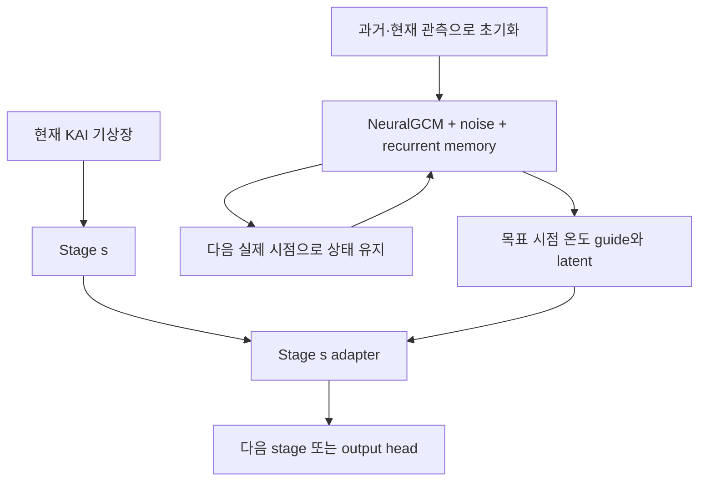

# KAI 각 stage의 stochastic manifold 보정

## 구현 범위

KAI의 공간 해상도 보존 구조를 유지하면서, 네 stage 중 선택한 위치에
NeuralGCM 기반 물리 guide와 recurrent latent를 사용하는 adapter를 붙였다.
`kai_backbone.py`는 제공된 KAI-Atmos ZIP의 `src/models.py`와 동일하다.
`downsample_layers` 이름, stride=1, 폭 48/96/192/288, 깊이 3/3/15/3을
유지하며 기존 backbone checkpoint를 그대로 읽는다. 기본 출력은 다음
시점의 전체 기상장이다. 원본 backbone의 padding/pointwise 구조도 그대로다.

이 경로는 기존 JAX `scripts/train.py`, `scripts/evaluate.py`와 병행해서
사용한다. 기존 NeuralGCM 훈련 모델이나 checkpoint schema를 변경하지 않는다.

## 시간과 stage의 구분

NeuralGCM + stochastic closure + recurrent latent가 하나의 물리적 궤적을
생성한다. 예를 들어 하루 간격의 KAI라면 generator를 24시간 진행하고,
그 시점의 물리장/latent를 **네 stage에서 공유**한다. 같은 하루에
generator를 stage마다 24시간씩 다시 진행하지 않는다.



Generator의 `z_t`, spatial memory, thermal memory, OU state, PRNG가 실제
시간을 따라 누적된다. Stage adapter는 상태를 저장하거나 noise를 추가로
추출하지 않는다. 서로 다른 ensemble member는 별도 generator 궤적을
사용한다. KAI도 각 member의 이전 예측을 다음 시점 입력으로 사용한다.

## 물리장과 feature의 연결

Stage feature `h_s`의 채널은 온도/기압 단위가 없으므로, 이를 NeuralGCM의
sigma-temperature 상태로 간주하지 않는다. 기존 generator의 decode를 통해
얻은 **pressure-level absolute temperature [K]**를 명시적으로 선택한다.

1. 압력층을 hPa로 지정하고 NeuralGCM data grid의 실제 층과 대조한다.
2. 물리장과 latent를 각각 해당 data/model grid에서 KAI 격자로 보간한다.
3. `[channel,longitude,latitude]`를 `[channel,latitude,longitude]`로 변환한다.
4. 온도 guide에는 해당 KAI 채널의 학습 mean/std를 적용한다.
5. Stage별 readout `R_s(h_s)`를 같은 온도 좌표계에 학습한다.

경도 보간은 주기적이고 위도 보간은 선형이다. 극에서는 경계 값을
연장한다. 이 보간은 guidance용이며 질량/에너지 보존 재격자화가 아니다.
기압·습도·바람을 직접 보정하는 물리 guide는 이번 경로에 추가하지 않았다.
다른 KAI 출력 변수는 학습된 채널 결합을 통해 간접적으로 영향을 받는다.

정규화된 물리 guide를 `q`, 생성 latent를 `z`, 학습된 gate를 `a_s`라 하자.

### residual mode

```text
innovation = q - R_s(h_s)
u = GELU(W_condition [h_s, innovation, z])
a_s = gate_max * sigmoid(W_gate u)
h_s_corrected = h_s + max_correction * a_s * tanh(W_delta u)
```

### filter mode

```text
candidate = Lift_s([q, z])
innovation = q - R_s(h_s)
a_s = gate_max * sigmoid(W_gate GELU(W_condition [h_s, innovation, z]))
h_s_corrected = h_s + max_correction * a_s * tanh(candidate - h_s)
```

각 feature 원소의 변화는 `max_correction * gate_max` 이하다. 기본값은
0.1과 1.0이며, gate bias=-2에서 시작한다. 이것은 **feature 단위의 bound**다.
물리량의 에너지 보존이나 정확한 manifold projection을 보장하지 않는다.
`filter`는 학습된 guide를 향한 nudging이며 Bayesian assimilation filter가 아니다.

## 학습 범위와 손실

첫 버전은 **고정된 JAX generator + PyTorch adapter 학습**이다.
JAX → NumPy → PyTorch 경계를 지나므로 KAI 손실이 NeuralGCM/latent-transition
계수까지 역전파되지 않는다. Generator는 기존 경로에서 먼저 학습해야 한다.
진정한 공동학습은 별도의 differentiable framework 연결이 필요하다.

기본적으로 학습된 KAI backbone도 고정하고 네 adapter만 학습한다.
고정된 backbone 연산을 통해 stage adapter까지 gradient는 전달된다.
`--train-backbone`으로 backbone과 adapter를 함께 학습할 수 있다.

```text
loss = empirical ensemble CRPS
     + mean_mse_weight * MSE(ensemble mean, truth)
     + stage_loss_weight * mean_s MSE(R_s(h_s_corrected), q)
```

기본 가중치는 각각 1, 0.1, 0.1이다. 면적 가중치는 실제 위도에서 계산한
cos(latitude)를 사용한다. 이 CRPS는 유한 empirical ensemble의 점수이며,
기존 JAX 경로의 fair-CRPS와 추정 방식이 다르다. 평균 MSE 및 guide 정렬은
보조 목적이므로 calibration과 과도한 guide 의존을 별도로 평가해야 한다.
`--loss mse` 및 `--loss relative-l2`도 지원한다.

학습 rollout은 미래 정답을 입력으로 되먹이지 않는다. 모든 lead에서 예측을
재입력하며, 미래 관측은 loss에만 사용한다. Stage 정렬의 target은 미래
관측이 아니라 **현재 origin에서 생성한 NeuralGCM 예측**이다.

## 실행

### 1. 설치와 연결 검증

```bash
git clone --branch feature/kai-stage-manifold --recurse-submodules \
  https://github.com/nayehyeon61-glitch/Neural-GCM-feat-stochastic.git
cd Neural-GCM-feat-stochastic
python -m pip install -e '.[kai,test]'
python scripts/smoke_kai.py
JAX_PLATFORMS=cpu python scripts/smoke_kai.py --real-neuralgcm
```

GPU PyTorch/JAX 환경은 서버에 맞게 설치한다. 아래 입력 경로는 예시이며
실제 학습 checkpoint/파일로 대체해야 한다. `runs/` 같은 출력은 Terra에서
`/lustre/home/yehyeon` 하위의 작업 디렉터리에 둔다. 원본 ERA5 자료는 수정하지 않는다.

### 2. 입력 준비

- 학습된 NeuralGCM checkpoint와 그 checkpoint를 사용해 학습한 recurrent
  closure NPZ. `latent_dim>0`, `spatial_mode=recurrent`가 필요하다.
- 기존 `prepare_neuralgcm_data.py`로 checkpoint grid/층/단위를 맞춘 NetCDF.
- 동일 source encoder의 `prepare_spatial_history.py` 산출물. 과거 이력과
  정확한 origin latent가 필요하며 future source latent는 요구하지 않는다.
- KAI NetCDF: `fields(time,channel,lat,lon)` 또는 latitude/longitude 이름,
  명시적인 날짜와 채널·좌표. 파일에는 정규화 전 물리량이 들어 있어야 한다.
- KAI 학습 자료에서 구한 전체 채널 mean/std NPY. 입력/출력의 채널 순서는 동일하다.

업로드된 KAI ZIP에는 67개 채널의 변수/층 매핑이 없으므로 **T500/T850의
인덱스를 추측하지 않는다.** 실제 채널 순서를 확인해 아래 두 변수를 설정한다.
`--pressure-levels 500,850`는 z500/z850가 아니라 temperature 500/850 hPa다.

### 3. 실제 generator의 guide 저장

```bash
# 실제 데이터의 온도 채널 인덱스로 먼저 설정한 뒤 실행한다.
: "${KAI_T500_CHANNEL:?Set the actual T500 channel index}"
: "${KAI_T850_CHANNEL:?Set the actual T850 channel index}"

python scripts/prepare_kai_guides.py \
  --base-checkpoint /path/to/neuralgcm_checkpoint.pkl \
  --trust-base-checkpoint \
  --closure /path/to/trained_recurrent_closure.npz \
  --data /path/to/neuralgcm_prepared.nc \
  --spatial-history /path/to/source_spatial_history.npz \
  --kai-data /path/to/kai_fields.nc \
  --global-means /path/to/global_mean.npy \
  --global-stds /path/to/global_std.npy \
  --temperature-channels "$KAI_T500_CHANNEL,$KAI_T850_CHANNEL" \
  --pressure-levels 500,850 \
  --interval-hours 24 --horizon-steps 4 --ensemble-size 4 \
  --output-dir runs/kai_guides
```

기존 generator 학습의 thermal warmup 및 spatial history 초기화 설정을 재사용한다.
SST/sea ice는 origin 값을 유지하고 내부 sim_time만 진행한다. `--without-targets`는
KAI의 미래 관측이 없는 순수 예측용 archive를 만든다. `--start-time`, `--end-time`,
`--max-origins`, `--stride`로 처리 범위를 제한한다. 기존 파일은 덮어쓰지 않는다.

각 origin NPZ에는 다음이 들어 있다.

| 배열 | shape | 의미 |
|---|---|---|
| initial | C,H,W | origin의 정규화된 KAI 기상장 |
| targets | L,C,H,W | loss용 정규화 정답; 예측에서는 생략 가능 |
| physical_guides | M,L,P,H,W | member별 생성 온도 guide |
| latent_guides | M,L,D,H,W | 같은 member/lead의 생성 latent |
| latitude, longitude | H / W | KAI 좌표 |
| lead_hours | L | 실제 예측 시간, Day 0 미포함 |
| metadata_json | scalar string | 날짜·층·채널·정규화·generator hash·학습 종료 날짜 |

M=ensemble member, L=lead, P=선택한 온도층, D=source latent 채널 수다.
한 origin씩 저장하지만 한 origin의 M×L 공간장과 native 입력 자료는 메모리에
올라온다. 먼저 낮은 해상도와 짧은 horizon에서 실행 비용을 확인해야 한다.

### 4. KAI stage adapter 학습

아래 날짜는 예시다. 실제 chronological split으로 변경한다. Generator의
학습 및 model-selection validation 종료일은 KAI `train-before`보다 빨라야 한다.
외부 pretrained KAI 및 source encoder/정규화의 학습 기간도 별도 확인한다.

```bash
python scripts/train_kai.py \
  --data runs/kai_guides \
  --kai-checkpoint /path/to/kai_best_ckpt.tar \
  --train-before 2020-01-01 --validation-before 2021-01-01 \
  --mode residual --stages 0,1,2,3 \
  --stage-loss-weight 0.1 --max-correction 0.1 \
  --epochs 30 --lr 1e-3 --device cuda \
  --output runs/kai_stage_residual/best.pt
```

- `--mode filter`: guide lift를 향한 filtering/nudging 실험.
- `--stages 0`: 첫 stage만, `--stages 3`: 마지막 stage만.
- `--stages 0,1,2,3`: 네 stage 전체.
- `--train-backbone`: backbone도 훈련. KAI checkpoint를 생략하면 무작위 초기화부터 학습.
- 원본 checkpoint는 `model_state`, `state_dict`, plain tensor dict 및 DDP의
  `module.` prefix를 지원한다. 안전한 weights-only loader를 사용한다.
- `--kai-step-hours`는 사전학습된 KAI의 실제 예측 간격이다(기본 24h).
  Guide 간격과 다르면 학습을 거부한다. 원본 checkpoint에는 해당 정보가
  없으므로 다른 lead의 checkpoint를 쓸 때 실제 학습 설정을 확인해 명시한다.
  Backbone을 처음부터 훈련하면 archive의 간격으로 학습한다.
- Train/validation 경계를 넘는 window는 버린다. validation 전체 loss가 최소인
  checkpoint를 저장한다. 이 새 경로는 optimizer resume 기능을 제공하지 않는다.

### 5. 추론 및 원본 backbone 비교

```bash
python scripts/predict_kai.py \
  --checkpoint runs/kai_stage_residual/best.pt \
  --data runs/kai_test_guides --device cuda \
  --output runs/kai_stage_predictions

python scripts/predict_kai.py \
  --checkpoint runs/kai_stage_residual/best.pt \
  --data runs/kai_test_guides --device cuda --baseline \
  --output runs/kai_baseline_predictions
```

입력 archive의 grid, timestep, 채널, 정규화, generator hash가 checkpoint와
맞아야 한다. Horizon과 member 수는 달라도 된다. 출력에는 정규화 예측과
물리 단위로 복원한 예측이 모두 있으며, 첫 항목은 정확히 첫 forecast lead다.
미래 targets가 없어도 예측 가능하다. 출력 metadata는 validation 이후의
origin인지 표시한다. 평가 수치에 쓰려면 held-out origin을 사용한다.

`--baseline`은 저장된 backbone을 직접 실행한다. Backbone을 고정해 학습했다면
원본 pretrained KAI와 동일하다. `--train-backbone`으로 수정했다면 이는
**동일하게 fine-tune된 backbone의 adapter-off 비교**이며, 원래 pretrained
baseline 비교에는 원래 checkpoint를 별도로 유지해야 한다.

## Python 연결

```python
from ngcm_memory.kai import KAI, StageAdapterConfig, StageManifoldKAI, load_kai_checkpoint

backbone = KAI(in_chans=67, out_chans=67)
load_kai_checkpoint(backbone, "kai_best_ckpt.tar")
model = StageManifoldKAI(
    backbone,
    StageAdapterConfig(physical_channels=2, latent_channels=64,
                       stage_indices=(0, 1, 2, 3), mode="residual"),
).freeze_backbone()
# 64는 예시. 실제 generator의 config.latent_dim으로 맞춘다.
# x: B,67,H,W; q: B,2,H,W; z: B,64,H,W; 동일 member/목표시점/grid
prediction, readouts = model.forward_with_diagnostics(x, q, z)
baseline = model(x, enabled=False)
```

## 검증과 해석

검증 항목은 disabled exact equivalence, stage별 영향, bounded correction,
고정 backbone을 통한 다단계 gradient, 원본 checkpoint 로드, 실제
NeuralGCM decode와 축/압력/정규화 연결, 누적 memory 보존, 미래 정답
비사용, temporal split, 학습/예측 archive 호환성이다.

Noise 제거 비교는 generator 자체를 deterministic 설정으로 별도 학습·생성한다.
현재 export는 stochastic checkpoint의 설정을 임의로 바꾸지 않는다. 서로 다른
generator hash는 해당 adapter checkpoint와 혼용하지 않으며, 독립 ablation을 학습한다.

이 구현에는 기존 source encoder의 W2/KL/signed loss를 다시 학습하는 경로가 없다.
그 효과는 기존 source checkpoint/latent에 담긴다. Stage 정렬 loss 자체는 MSE다.
물리적 근거가 있는 guide를 CNN에 연결한 연구 가설이며, 보존 법칙·엄밀한
manifold 위 투영·장기 안정성·예측 정확도 향상은 별도 실험 대상이다.
